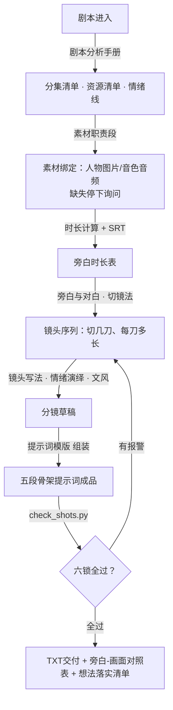
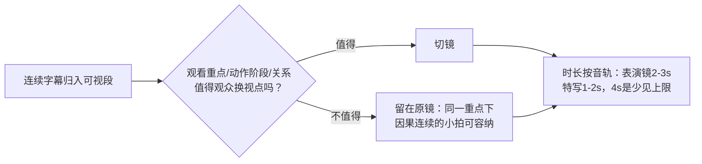

# 相柳导演技能（xiangliu-director）

  

**剧本进，Seedance 2.5 提示词成品出——五模块联动的 AI 短剧导演中枢。**

把一部短剧剧本变成可直接复制到视频生成工具里使用的专业提示词：以影视级导演的标准做剧本分析、分镜设计、情绪演绎与镜头语言组装，表演达到真人演绎水准，画面有冲击力，禁木头人式表演，禁平淡应付。

---

## 目录

- [它是什么](#它是什么)
- [生产流水线](#生产流水线)
- [五模块怎么协作](#五模块怎么协作)
- [核心算法：切镜法](#核心算法切镜法)
- [六锁自检](#六锁自检)
- [怎么用](#怎么用)
- [仓库结构](#仓库结构)
- [版本历史](#版本历史)

---

## 它是什么

短剧（推文剧、广告短剧、竖屏微短剧）的 AI 视频生产，难点从来不是"生成"，而是**导演**：

- 旁白念到"揉了揉他的头发"，画面到底该给几秒、切几刀？
- 一句台词怎么拆正反打，变脸那一瞬间怎么给镜头？
- 为什么模型总把人物演成蜡像，把"脸色煞白"刷成油漆？

这个技能就是把"导演"这件事做成**可执行的规则体系**：五本手册管五类专业决策，一个脚本管机械自检，一条流水线从头到尾。AI（相柳）按手册执行，人只出想法和验收。

**产出物**：每段一个 TXT 提示词文件，五段骨架格式，复制即可投喂 Seedance 2.5 等视频生成工具；文尾附旁白-画面对照表，逐镜可对账。

## 生产流水线



五个模块**上下游咬合**：上一步的产出是下一步的输入，任何一步缺材料（剧本、SRT、素材）立即向用户索取，禁止跳步。

## 五模块怎么协作

| 模块 | 手册 | 管什么 |
|---|---|---|
| 01 剧本分析 | 剧本分析手册.md / 时长计算.md | 分集、资源清单、情绪线；SRT→旁白时长表 |
| 02 资产管理 | 素材职责段.md | 人物图片绑五官防脸崩、音色音频按对白绑定、服装文生 |
| 03 分镜 | 旁白与对白.md / 镜头写法.md / 情绪演绎规则.md | 文本层切镜 + 镜头层写法 + 表演 |
| 04 提示词 | 提示词模版.md | 五段骨架：生成目标/镜头风格/素材职责/人物位置/镜头N |
| 05 文风 | 文风规则.md | 落笔定调：可见动作代替情绪套语，禁词边界 |

**回读纪律**：任何模块消费上游产出前必须回读本模块手册，禁止凭记忆写——这是"无记忆协作"的机制：规则文件自足，新会话拿到手册就能执行出同等质量。

## 核心算法：切镜法

v2.2.2 的核心更新，解决"旁白怎么变成镜头"：

> **SRT 行提供声音时间锚点，视觉节拍决定镜头。**
> 先将连续字幕归入可视段，一个镜头可以覆盖多条连续字幕；
> 只有在观看重点、动作阶段或关系发生**值得观众换视点的变化**时才切。
> 保留原音轨与 SRT 时间码，不为凑镜头压缩发声或动作。



几条落地判断：

- **切与合**：同框已能读到表情变化的，留在原镜也成立；多个观看重点互相争夺注意力才拆镜
- **移动过程拍法开放**：走的过程能载戏（高跟鞋、裙摆、刻意放慢）就给镜头，没戏就切结果状态；只禁干跟拍平铺
- **音画关系**：画面可先铺垫、旁白说完可留反应；提前展示结果前确认不剧透
- **对照表兜底**：一行旁白可拆多镜、一镜可覆盖多行，文尾对照表逐镜对账

## 六锁自检

每段提示词必须过 [scripts/check_shots.py](scripts/check_shots.py) 六把锁才能交付：

| 锁 | 检查 |
|---|---|
| 写法 | 景别槽拆得出"主体+景别词"；机位槽含"机位" |
| 变化 | 相邻两镜的主体/机位/景别至少两项不同 |
| 连续 | 同主体禁连拍三镜；同主体机位禁来回切 |
| 时长 | 单镜超4s报警；时间轴重叠/空档报警；段落超30s报警 |
| 禁词 | 硬禁项逐镜扫描（死死/紧绷/僵类/面部变色/眼神发亮/网文套式） |
| 骨架 | 镜2起正文以"承接"开头；每镜含"落幅" |

用法：`python scripts/check_shots.py 提示词文件.txt`

禁词表与文风规则同源——模型会把"煞白"刷成油漆、把"僵"演成蜡像，所以这些词在落笔层就被禁止，脚本层兜底。

## 怎么用

**安装**：将本仓库整体放入 TRAE 技能目录（如 `.trae/skills/xiangliu-director/`），AI 自动加载。

**两种用法**：

1. **想法直给（推荐）**——只说旁白范围＋画面想法，比如：
   > "从『她推开餐厅门』到『他摔杯子』，这段我要她站在雨里哭，变脸那下给我一个冷的反差，咔一下切断的感觉。"
   
   剧本/旁白/SRT 一次性给或给文件路径，拆段、算时、分镜全由相柳按流水线执行；交付附旁白-画面对照表（按音轨时段）＋想法落实清单（你的每条想法落在第几镜）。想法与旁白冲突时相柳会停下来问你，禁止瞒着改。

2. **全流程生产**——给剧本和素材，按流水线产出全部分集提示词，每集一个「第X集提示词」文件夹（段1.txt、段2.txt……＋旁白时长表）。

**素材要求**：人物五官图片（防脸崩的锚点，越准越好）；有对白的段落需要人物音色音频；SRT 字幕时间戳（没有则按时长估算并标注）。

## 仓库结构

```
xiangliu-director/
├── SKILL.md                          # 技能入口：铁律、使用模式、回读纪律、生产流程
├── README.md                         # 本文件
├── 手册/
│   ├── 01-剧本分析/
│   │   ├── 剧本分析手册.md            # 分集、资源清单、情绪线
│   │   └── 时长计算.md               # SRT→旁白时长表
│   ├── 02-资产管理/
│   │   └── 素材职责段.md             # 图片/音频/文生条目的绑定规则
│   ├── 03-分镜/
│   │   ├── 旁白与对白.md             # 切镜法（核心算法）、对白拆分、锚定衔接
│   │   ├── 镜头写法.md               # 五槽句序、机位景别运镜、正反打
│   │   └── 情绪演绎规则.md           # 四通道：动机+情绪+微表情+肢体
│   ├── 04-提示词/
│   │   └── 提示词模版.md             # 五段骨架、组装规矩、品味基准
│   └── 05-文风/
│       └── 文风规则.md               # 可见动作代替情绪套语、禁词边界
└── scripts/
    └── check_shots.py                # 六锁自检脚本
```

## 版本历史

| 版本 | 内容 |
|---|---|
| 2.2.2 | **切镜法**：SRT锚点+视觉节拍决定镜头、换视点切镜、时长按音轨；文风收窄（否定式作动作链收尾、肤色变化可写、避免生造词）；新增状态结论禁令（"笑僵在脸上"类改写可拍动作）；禁词补丁（补"僵在/笑僵"堵变体绕行，移除"脸变红"）；使用模式「想法直给」 |
| 2.2.1 | 全库校对错别字错别词；镜头写法机位词规范化（自造机位词清零）；音频条目定义统一为人物音色音频（有对白才放，无对白不放） |
| 2.2.0 | 音频条目规则定稿：剧情有谁的对白就添加谁的音色音频，无对白段一个不放；术语统一"人声音色参考" |
| 2.1.x | 五模块手册体系成型；六锁自检脚本上线；图片资产锚定规则（绑五官防脸崩） |

---

*相柳：九头皆明，一个不糊。*
